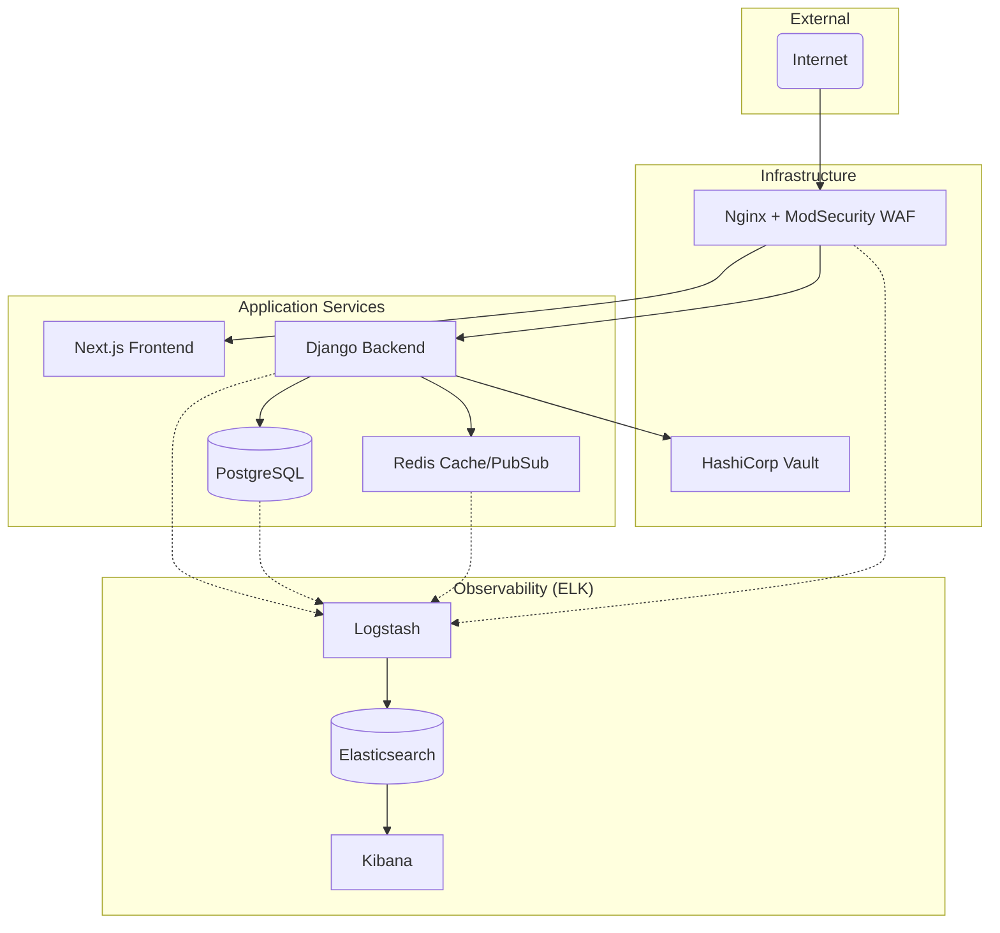

# 🚀 Transcendance


Welcome to **Transcendance**, a high-performance, real-time multiplayer gaming platform. This project recreates the classic Pong game with modern web technologies, a robust microservices architecture, and a focus on security and observability.

---

## 🌟 Key Features

- **🎮 Real-Time Gameplay**: Seamless, low-latency Pong matches powered by WebSockets.
- **🛡️ Advanced Security**: Built-in WAF (ModSecurity), secret management via HashiCorp Vault, and Two-Factor Authentication (2FA).
- **📊 Comprehensive Monitoring**: Fully integrated ELK Stack (Elasticsearch, Logstash, Kibana) for real-time logging and system health tracking.
- **👤 User Management**: Detailed profiles, matchmaking system, and friend lists.
- **✨ Premium UI/UX**: A stunning frontend built with Next.js, Tailwind CSS, and 3D elements using Three.js.

---

## 🏗️ Architecture Overview

Transcendance is built as a microservices application, ensuring scalability and isolation.



---

## 🛠️ Tech Stack

| Component | Technology |
| :--- | :--- |
| **Frontend** | [Next.js](https://nextjs.org/), [React](https://reactjs.org/), [Three.js](https://threejs.org/), [Tailwind CSS](https://tailwindcss.com/) |
| **Backend** | [Django](https://www.djangoproject.com/), [Django Channels](https://channels.readthedocs.io/), [DRF](https://www.django-rest-framework.org/) |
| **Database** | [PostgreSQL](https://www.postgresql.org/) |
| **Caching** | [Redis](https://redis.io/) |
| **Security** | [HashiCorp Vault](https://www.vaultproject.io/), [ModSecurity](https://www.modsecurity.org/) |
| **Observability** | [Elastic Stack (ELK)](https://www.elastic.co/elastic-stack) |
| **Deployment** | [Docker](https://www.docker.com/), [Docker Compose](https://docs.docker.com/compose/) |

---

## 🚀 Getting Started

### Prerequisites

- [Docker](https://www.docker.com/get-started) and [Docker Compose](https://docs.docker.com/compose/install/)
- `make` utility

### Installation & Launch

1. **Clone the repository**:
   ```bash
   git clone https://github.com/your-username/transcendance.git
   cd transcendance
   ```

2. **Build and start the services**:
   ```bash
   make build
   make up
   ```

3. **Initialize Vault** (if necessary):
   ```bash
   make init_vault
   ```

4. **Access the application**:
   - Frontend: `http://localhost:3000` (via Nginx proxy)
   - Kibana: `http://localhost:5601`
   - API Docs: `http://localhost/api/docs/` (if enabled)

---

## 📖 Additional Documentation

- [Backend Documentation](srcs/api/README.md) - *Detailed Django & API guide.*
- [Frontend Documentation](srcs/frontend/README.md) - *UI/UX and Three.js details.*
- [Nginx & Security](srcs/nginx/README.md) - *ModSecurity and CRS configuration.*

---

## 📜 License

This project is developed as part of the 42 curriculum. All rights reserved.
